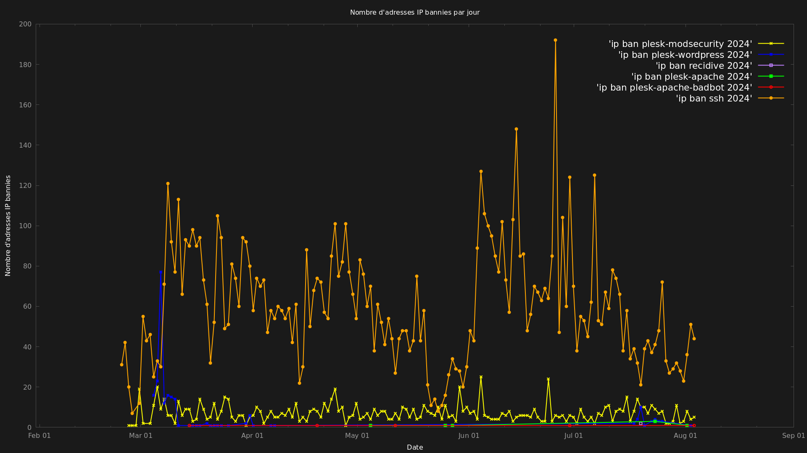

# Projet d'Analyse Fail2Ban



## Description
Ce projet fournit des scripts pour analyser et visualiser les tentatives de connexion bannies par Fail2Ban sur un serveur. Il génère des rapports quotidiens et des graphiques pour aider à comprendre les tendances des attaques et l'efficacité de la protection Fail2Ban.

## Fonctionnalités
- Extraction quotidienne des tentatives de connexion bannies à partir des logs Fail2Ban, basée sur des adresses IP
- Génération de graphiques montrant le nombre de tentatives bannies par jour pour chaque service
- Organisation des données et graphiques par année
- Automatisation via des tâches cron

## Prérequis
- Fail2Ban installé et configuré sur le serveur
- Bash
- Gnuplot
- Accès aux logs système (rsyslog ou journalctl)

## Structure du Projet
```
/
├── opt/
│   └── extraction_fail2ban_rsyslog.sh (ou extraction_fail2ban_journalctl.sh)
├── home/user/
│   ├── graphique_bannissements_fail2ban.gp
│   └── [ANNÉE]/
│       ├── ip_ban_[SERVICE]_[ANNÉE].txt
│       └── images/
│           └── [DATE]_ip_ban_fail2ban_4k.png
```

## Installation et Configuration
1. Placez le script d'extraction approprié dans `/opt/` :
   - Pour rsyslog : `extraction_fail2ban_rsyslog.sh`
   - Pour journalctl : `extraction_fail2ban_journalctl.sh`

2. Placez `graphique_bannissements_fail2ban.gp` dans le répertoire home de l'utilisateur.

3. Créez les répertoires nécessaires pour les données et les images.

4. Configurez les variables dans les scripts :
   - Dans le script d'extraction (rsyslog ou journalctl) :
     ```bash
     REPERTOIRE_DESTINATION="/home/votre_utilisateur/$(date -d yesterday +%Y)"
     UTILISATEUR="votre_utilisateur"
     GROUPE="votre_groupe"
     ```
   - Il est fortement recommandé de personnaliser ces variables selon votre environnement spécifique.
   - Assurez-vous que les chemins dans `graphique_bannissements_fail2ban.gp` correspondent à votre structure de répertoires.

5. Configurez les tâches cron :
   ```
   # Pour l'extraction des données
   5 0 * * * /opt/extraction_fail2ban_rsyslog.sh >> /var/log/suivi_bannissements_fail2ban.log 2>&1

   # Pour la génération du graphique
   15 0 * * * cd /home/votre_utilisateur && gnuplot graphique_bannissements_fail2ban.gp && chmod 600 /home/votre_utilisateur/[ANNÉE]/images/*
   ```

## Personnalisation
- Il est crucial de personnaliser les variables dans les scripts selon votre environnement spécifique. Cela inclut les chemins de répertoires, les noms d'utilisateur et de groupe, et tout autre paramètre spécifique à votre système.
- Vous pouvez ajuster les noms de fichiers générés en modifiant les scripts si vous préférez une nomenclature différente.
- Ajustez les horaires des tâches cron selon vos besoins.

## Sécurité
- Les fichiers de données et les images sont créés avec des permissions restreintes (600).
- Assurez-vous que seuls les utilisateurs autorisés ont accès aux scripts et aux données générées.

## Contribution
Ce projet a été développé par Ronan DAVALAN. Les contributions sont les bienvenues. Veuillez soumettre des pull requests pour toute amélioration ou correction de bugs.

## Licence
Ce projet est sous licence MIT.

## Remerciements
Ce projet a été développé avec l'aide de divers assistants IA, notamment ChatGPT, Claude AI et Perplexity AI.
